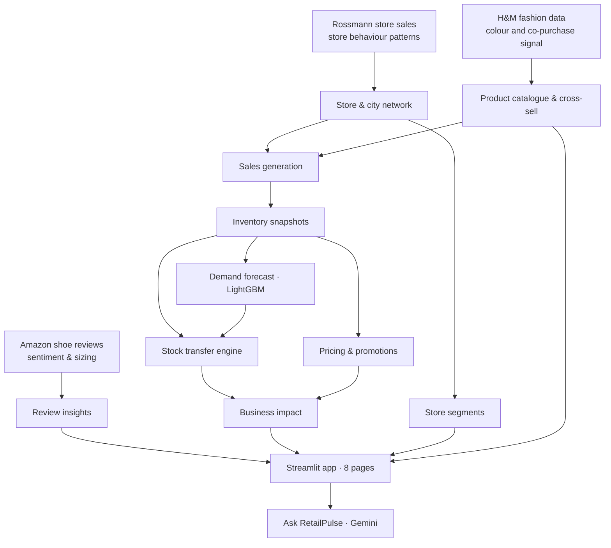

<div align="center">

# RetailPulse 360

**Decision support for a multi-store footwear chain: forecast demand, move stock between stores, price slow stock sensibly, and show what each decision is worth.**

[](https://retailpulse360.streamlit.app)
[](https://www.python.org/)
[](https://lightgbm.readthedocs.io/)
[](LICENSE)

[**Try the live app**](https://retailpulse360.streamlit.app) · [Results](#results) · [How it works](#how-it-works) · [Data](#where-the-data-comes-from) · [Run it](#run-it-locally)

</div>

---

## The problem

In a shoe chain with 190 stores across Pakistan, the same item can sell out in one city while it sits untouched in another. One store loses sales; the other ties up cash and eventually discounts. Forecasting total sales doesn't fix that. You need demand per store, product and size, and then a decision about what to actually move, reorder or mark down.

RetailPulse 360 is my attempt at that whole chain of decisions. I built it around a real Pakistani footwear retailer's scale (190 stores, 94 cities), using public datasets for behaviour and clearly sourced assumptions where no public data exists. No number in the app is made up and presented as fact.

## What it does

- **Forecasts daily demand** for every store and product with LightGBM, using a Poisson objective because most store-product days sell zero.
- **Recommends stock transfers** between stores, using road-adjusted distance and an allocation step that never promises the same surplus to two stores.
- **Suggests discounts** based on price elasticity: a small discount for slow sellers, a clearance discount for stock that isn't moving at all.
- **Groups stores** by how they perform against stores of the same size, not by raw revenue.
- **Shows cross-sell pairs** ("customers also bought") from real co-purchase behaviour.
- **Puts a value on each decision** in rupees, alongside what the system can't fix.
- **Answers questions in plain English** through a Gemini assistant that only uses the platform's own figures.

## Results

| Area | Result |
|---|---|
| Demand forecast | 97.6% of predictions within 1 unit of actual; beats a naive baseline by 6.5% on MAE and 29.6% on RMSE |
| Stock transfers | 350 transfers recovering about PKR 2.8M in revenue from stock that wasn't selling where it sat |
| Pricing | About PKR 16,000 a day of margin protected on slow-moving stock |
| Store segments | 4 groups independent of store size: Rising Stars, Steady Performers, Lean & Consistent, At-Risk |
| Reviews | 8,208 shoe reviews scored for sentiment, checked against their star ratings |

### Findings I didn't expect

- **The forecast's advantage shows up on spike days.** The model beat the baseline by 10.2% in the run-up to Eid versus 6.5% on normal days, which is why RMSE improved far more than MAE.
- **Transfers solve less than you'd hope.** Only 4.2% of shortages had a matching surplus anywhere in the network. The other 96% need a supplier reorder, and the app says so plainly rather than overselling the transfer engine.
- **Discounts can't raise revenue here.** With shoe demand elasticity at 0.7 (inelastic), every discount on an item that already sells lowers both revenue and margin. That's why the pricing logic splits slow stock from dead stock instead of using one rule.
- **My first store clustering was useless.** Clustering on raw revenue just rebuilt the store-size labels. Normalising each store against its size peers produced segments that mix large, medium and small stores, which is actual new information.

## How it works



The pipeline runs through 13 notebooks, one per stage, and each stage's output feeds a page in the app.

## Where the data comes from

| Source | What I used it for |
|---|---|
| [Rossmann Store Sales](https://www.kaggle.com/c/rossmann-store-sales) (Kaggle) | How stores behave: weekly rhythm, promo response, trend, volatility, holiday lift. I used ratios only, never the German sales figures themselves. |
| [H&M Personalized Fashion Recommendations](https://www.kaggle.com/competitions/h-and-m-personalized-fashion-recommendations) (Kaggle) | Colour popularity and which categories are bought together |
| Amazon Men's & Women's Shoe Reviews (Kaggle) | Customer sentiment and sizing comments |
| Sourced assumptions | Actual Eid dates 2024–2026, Pakistani shoe sizing, a 40% gross margin (industry data), 0.7 price elasticity for footwear (published research) |

Raw datasets aren't in the repo because of their size; download them from the links above. Processed data and the trained model are included through Git LFS.

## Tech stack

| Area | Tools |
|---|---|
| Data and modelling | Python, pandas, NumPy, scikit-learn, LightGBM, statsmodels |
| App and charts | Streamlit, Plotly |
| Assistant | Google Gemini (`google-genai`) |
| Geography | Haversine distance with a road-distance adjustment |
| Hosting | Streamlit Community Cloud, Git LFS |

## Run it locally

```bash
git clone https://github.com/hamazmubashar/RetailPulse360.git
cd RetailPulse360
conda create -n retailpulse python=3.11 -y
conda activate retailpulse
pip install -r requirements.txt
cd app
streamlit run Dashboard.py
```

The **Ask RetailPulse** page needs a Gemini key: add `GEMINI_API_KEY=your_key_here` to a `.env` file in the project root. Every other page works without it.

## Project structure

```
RetailPulse360/
├── app/
│   ├── Dashboard.py          # home page
│   ├── pages/                # the other app pages
│   └── utils/                # data loading and styling
├── notebooks/                # 13 notebooks, from store behaviour to business impact
├── datasets/processed/       # outputs of each stage (Git LFS)
├── artifacts/                # trained forecasting model (Git LFS)
└── requirements.txt
```

## What it can't do

- Transfers cover only 4.2% of shortages; most need new stock from suppliers.
- The elasticity model can't estimate sales for stock selling zero, so the clearance discount's impact isn't quantified.
- Only 1.6% of reviews mention sizing, so sizing feedback is a hint, not a signal to act on.
- Sports and men's formal shoes have no colour or cross-sell signal in the H&M data, and the app shows that gap rather than filling it.
- There's no customer-level data, so segmentation is by store, not by shopper.

## Author

**Hamaz Mubashar** · [LinkedIn](https://www.linkedin.com/in/hamazmubashar) · [GitHub](https://github.com/hamazmubashar)

Released under the [MIT License](LICENSE).
